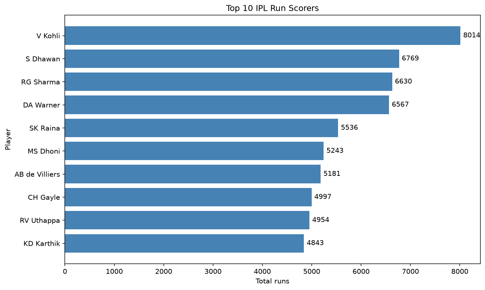
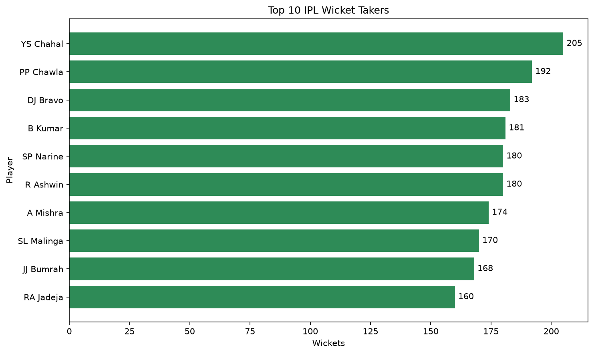
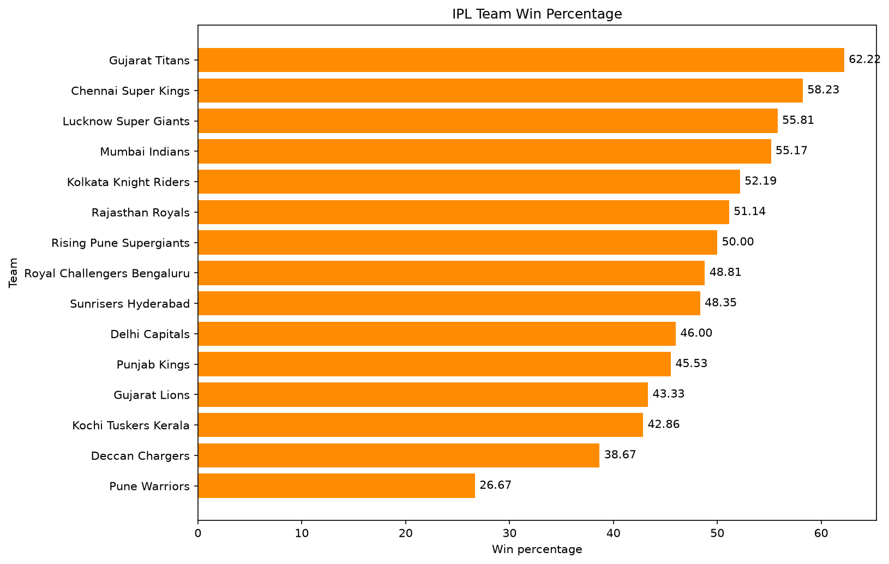
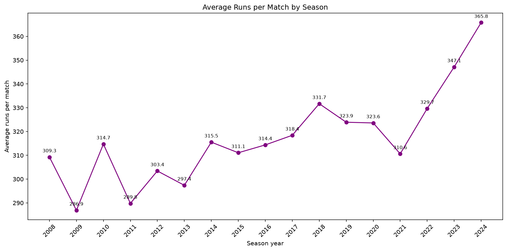

# IPL Cricket Stats ETL Pipeline

A beginner Python project that takes public IPL match and ball-by-ball CSV files and turns them into a SQLite database, SQL answers, and charts.

It is built as a small extract-transform-load pipeline you can run with one command.

## What it does

1. **Extract** — read `matches.csv` and `deliveries.csv` from `data/raw/`.
2. **Clean** — fix team names, missing values, duplicates, and data types, then save cleaned CSVs.
3. **Load** — create a SQLite database and fill `players`, `matches`, and `deliveries`.
4. **Query** — run SQL for top batters, best bowlers, team win rates, and season totals.
5. **Chart** — draw four PNG charts from those query results.

## Tools used

- **Python** — runs every step of the pipeline.
- **pandas** — reads, cleans, and writes CSV files.
- **sqlite3** — stores the cleaned data in `data/ipl.db` and runs the SQL queries.
- **matplotlib** — saves the four charts as PNG images.

## Folder structure

```text
ipl-etl-pipeline/
├── charts/                 # PNG charts (shown below)
├── data/
│   ├── raw/                # put the Kaggle CSVs here (not on GitHub)
│   └── clean/              # cleaned CSVs created by the pipeline
├── output/                 # query results as CSV
├── sql/                    # the four SQL queries
├── src/                    # Python scripts
│   ├── clean_data.py
│   ├── create_database.py
│   ├── load_database.py
│   ├── run_queries.py
│   ├── make_charts.py
│   └── run_pipeline.py
├── requirements.txt
└── README.md
```

## How to run it

1. Download the IPL CSV files from Kaggle and put them in `data/raw/` as `matches.csv` and `deliveries.csv`.
2. Install the libraries:

```bash
pip install -r requirements.txt
```

3. Run the full pipeline:

```bash
python src/run_pipeline.py
```

If a step fails, the pipeline stops there and tells you which step failed.

## Results









Sample findings from `output/`:

- Virat Kohli is the top run scorer, with **8014** runs off **6069** balls (strike rate **132.05**).
- YS Chahal took the most bowler-credited wickets, with **205**.
- Gujarat Titans have the highest win rate, **62.22%** (28 wins in 45 matches).
- Matches got higher scoring over time: average runs per match were **286.89** in 2009 and **365.79** in 2024.

## Data source

The data comes from a public Kaggle IPL dataset: [IPL Complete Dataset on Kaggle](https://www.kaggle.com/datasets/patrickb1912/ipl-complete-dataset-20082020).
